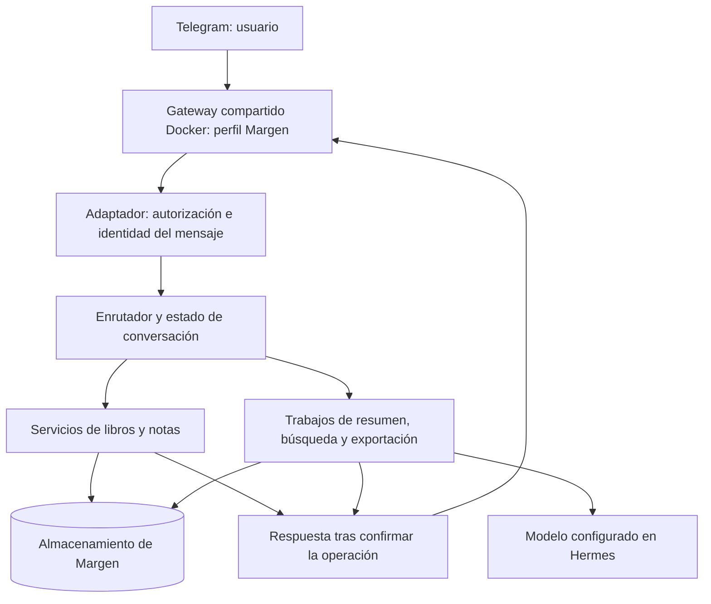

# Plan técnico de Margen

- **Versión:** 1.1.0
- **Estado:** Plan aprobado; revisión operativa Docker autorizada por el usuario
- **Fecha:** 2026-10-18
- **Edición pública:** nombres personales e inventario ajeno a Margen omitidos; sin cambios funcionales.
- **Base funcional:** [spec.md](spec.md), versión 1.0.0 aprobada.
- **Gobierno:** [constitution.md](../../memory/constitution.md), versión 1.0.0 aprobada.

## Revisión operativa 1.1 — Docker definitivo (registrada el 2026-10-22)

El usuario autoriza mantener Docker como despliegue definitivo después de los ensayos del laboratorio. Constitución y requisitos funcionales permanecen en versión 1.0.0. Esta revisión sustituye las decisiones de instalación y supervisión nativas de 1.0; las referencias al inventario nativo de 2026-10-18 son evidencia histórica, no instrucciones para el despliegue actual.

- Imagen oficial ARM64 construida desde la misma revisión Hermes; runtime verificado en Docker: Python 3.14.7. Python 3.11.15 se conserva como entorno local de pruebas del dominio, no como runtime del gateway definitivo.
- Gateway compartido `default` bajo s6 que sirve el perfil `margen`. Contenedor estable `margen`, proyecto Compose `margen`, política `unless-stopped`, gracia de apagado 60 s y comprobación de estado del proceso y Telegram. El arranque al iniciar el anfitrión depende de que el daemon Docker esté habilitado.
- Volumen externo existente `margen-hermes-lab_data`, sobre NVMe; ruta de base dentro del contenedor `/opt/data/profiles/margen/plugin-data/margen/data.db`. Se conservan credenciales, perfil, modelos, dependencias y libros ficticios del laboratorio; no hay borrado ni nuevo bot implícitos.
- Promoción con copia SQLite verificada y exclusión de instancias concurrentes conocidas; detener el laboratorio antes del definitivo. Reversión de arranque al laboratorio, con el mismo volumen, sin revertir datos o código por accidente.
- No instalar unidad systemd de usuario por perfil, modificar el venv nativo ni migrar los demás gateways. La unidad ilustrativa anterior queda retirada.
- La recuperación local ya fue ensayada; la copia externa y las restantes puertas de aceptación siguen pendientes. No se acepta operativamente el producto solo por preparar Compose.

Procedimiento vigente y fuente de comandos: [PRODUCTION.md](../../../deployment/docker/PRODUCTION.md). El resto del documento conserva los contratos y decisiones funcionales aprobados, aplicando estas sustituciones a sus referencias de entorno.

## 1. Resultado previsto y alcance de este documento

Implementar Margen como un perfil personal de Hermes Agent, con captura por Telegram, conservación duradera de notas y operaciones verificables. El libro activo, las notas y las interacciones pendientes deben sobrevivir a reinicios y a cambios de conversación del modelo.

Este documento propone una arquitectura y contratos propios de Margen. El entorno ha sido identificado por el usuario y se ha consultado la documentación oficial fijada a su revisión de Hermes. Esto no equivale a una prueba de compatibilidad en ejecución: no hay conexión a la Raspberry desde esta sesión y no se han instalado componentes, modificado perfiles ni probado el bot.

### Entorno de destino confirmado por el usuario

| Elemento | Valor comunicado |
| --- | --- |
| Equipo | Raspberry Pi 5, Linux ARM64 (`aarch64`), anfitrión `claw`. |
| Memoria | 16 GB nominales en el equipo de referencia. |
| Almacenamiento | NVMe local con ext4; el directorio de datos de Hermes reside en ese soporte. |
| Backup existente | Copia incremental de archivos mediante `rsync -av` hacia `/mnt/backup-ssd/backups/`, en un SSD externo exFAT. No es una imagen del disco. |
| Montaje esperado del backup | el usuario confirma que el SSD externo debe permanecer montado en `/mnt/backup-ssd` y se utiliza únicamente para backups. Su ausencia en el diagnóstico no corresponde al funcionamiento previsto. |
| Sistema | Debian GNU/Linux 13 (trixie), kernel `6.18.50+rpt-rpi-2712`. |
| Hermes | `git describe` devuelve `v0.22.2+canary.20261018T065527Z-60-g22063fc099`. La identificación stable anterior no se toma como evidencia del checkout actual; no se deduce el canal del proceso activo a partir de una etiqueta Git. |
| Revisión | `22063fc099ec9ad8357d7f8f6e6248a0400680d3`, coincide con el prefijo examinado. Se fija como base de compatibilidad. |
| Instalación | Git, en `/home/claw/.hermes/hermes-agent`. |
| Python examinado | `3.11.15` en `/home/claw/.hermes/hermes-agent/venv/bin/python`. Sustituye la hipótesis inicial 3.14.7 para el diseño de Margen; falta comprobar el ejecutable de la futura unidad. |
| SDK OpenAI instalado | `2.24.0`; su presencia no identifica el proveedor ni el modelo configurados. |
| Dependencias examinadas | python-telegram-bot `22.8`, ruamel.yaml `0.18.17`, PyYAML `6.0.3`. |
| SQLite | `3.53.1`, FTS5 disponible y API de backup presente. Comprobación efectuada en memoria, sin abrir las bases de Hermes. |

El usuario confirma OpenRouter como proveedor y aprueba `anthropic/claude-haiku-5.5` como modelo inicial de resumen. El entorno utiliza unidades systemd de usuario por perfil. Debe preservarse la configuración de los perfiles ajenos a Margen. La decisión posterior autoriza Docker para Margen; no se requiere GPU ni inferencia remota para la búsqueda.

### Resumen público del diagnóstico

El diagnóstico confirma ARM64, NVMe/ext4, Python 3.11, SQLite con FTS5 y supervisión mediante unidades systemd de usuario. El perfil Margen no estaba desplegado. El inventario de otros perfiles y el informe original se conservan fuera de la edición pública. El montaje externo del backup sigue siendo una dependencia de validación, fuera del alcance de reparación de este proyecto.

La Constitución y la especificación siguen aprobadas sin cambios. El usuario ha aprobado el plan técnico completo, incluidas las decisiones de canal, modelos, convivencia de interacciones y operación descritas aquí, el 2026-10-18. Las pruebas y comprobaciones de implementación y despliegue siguen pendientes de ejecución.

## 2. Evidencia y comprobación de compatibilidad

Documentación oficial consultada el 2026-10-18:

| Fuente | Hecho que respalda |
| --- | --- |
| [Perfiles](https://hermes-agent.nousresearch.com/docs/user-guide/profiles) | Separación del estado por perfil; un perfil no impone aislamiento del sistema de archivos. |
| [Telegram](https://hermes-agent.nousresearch.com/docs/user-guide/messaging/telegram) | Gateway de Telegram y restricción por identificadores de usuario; el transporte limita el tamaño de los mensajes. |
| [Extensiones Python](https://hermes-agent.nousresearch.com/docs/developer-guide/plugins) | Registro de comandos mediante `ctx.register_command`; los comandos nativos tienen prioridad en caso de conflicto. |
| [Hooks](https://hermes-agent.nousresearch.com/docs/user-guide/features/hooks) | `post_gateway_admission` permite consumir texto admitido; el callback debe gestionar sus errores para impedir la caída al agente. La deduplicación es responsabilidad de la extensión. |
| [Acceso al modelo](https://hermes-agent.nousresearch.com/docs/developer-guide/plugin-llm-access) | Existe una interfaz de inferencia administrada por Hermes para sus extensiones. |

Las páginas anteriores son referencias generales. Para el destino se ha consultado además la documentación del commit comunicado:

- [Guía de extensiones en `22063fc099ec`](https://github.com/NousResearch/hermes-agent/blob/22063fc099ec/website/docs/developer-guide/plugins/index.md): documenta el registro de manejadores nativos de plataforma mediante `ctx.register_platform_handler`, además del almacenamiento de extensiones con `plugin_data_dir` y `plugin_db`.
- [Hooks en esa revisión](https://github.com/NousResearch/hermes-agent/blob/22063fc099ec/website/docs/user-guide/features/hooks.md): permite distinguir el punto de admisión de texto del despacho de comandos.
- [Inferencia de extensiones en esa revisión](https://github.com/NousResearch/hermes-agent/blob/22063fc099ec/website/docs/developer-guide/plugin-llm-access.md): documenta `ctx.llm.acomplete` y la herencia del proveedor/modelo del usuario, sin gestionar sus credenciales directamente.
- [Perfiles en esa revisión](https://github.com/NousResearch/hermes-agent/blob/22063fc099ec/website/docs/user-guide/profiles.md): referencia para crear el perfil separado.

Antes de validar el despliegue se comprobarán contra el código instalado y con pruebas de contrato:

1. Carga de la extensión únicamente para el perfil Margen.
2. Registro y ejecución de todos los comandos acordados, sin colisiones.
3. Captura del texto sin comando después de autorizar al remitente, con identificador estable del mensaje, sin modificación por el modelo.
4. Acceso al identificador original también para `/nota` y para las demás operaciones mutables. El texto del mensaje no sustituye a ese identificador.
5. Entrega de documentos Markdown y respuestas divididas, avisos de progreso y acceso al modelo configurado.

El hook de admisión se ejecuta después de determinadas rutas de comandos; no basta por sí solo para cubrir la deduplicación de todos ellos. La propuesta para Telegram es un manejador nativo registrado mediante la interfaz pública, con acceso al mensaje original tanto para texto como para comandos de Margen. No se parchearán funciones privadas de Hermes como solución implícita.

El manejador se limitará al bot de Margen y al chat privado configurado. Autorizará los IDs del remitente y chat antes de guardar o mostrar información, porque la ruta nativa puede preceder a las comprobaciones del gateway. Excluirá callbacks y eventos administrativos de Hermes y no reemplazará sus flujos de aprobación. Los comandos de Margen consumidos no continuarán también al manejador general: se probará explícitamente la ausencia de doble despacho. Los comandos nativos se delegarán sin colisión y los desconocidos recibirán el error funcional acordado.

La fábrica nativa se documenta con acceso a la `Application` de python-telegram-bot. El diagnóstico identifica su versión como 22.8; los filtros, grupos y detención de propagación se verificarán en pruebas de contrato contra ella. La autorización propia y la separación de comandos son condiciones de aceptación de esta integración.

## 3. Arquitectura propuesta



### Perfil y canal

- Perfil denominado `margen`, con identidad e instrucciones propias en `SOUL.md`.
- Decisión aprobada por el usuario: bot de Telegram propio, asociado exclusivamente al perfil `margen`, con conversación privada y acceso limitado a su usuario. Se ejecutará en Docker ARM64 sobre la Raspberry, con la imagen fijada y el gateway compartido descritos en la revisión 1.1.
- Autorización por identificadores estables del remitente y del destino; no por nombre visible ni por texto enviado.
- La identidad numérica del usuario y la credencial del bot se configurarán durante el despliegue por un canal local seguro; no se solicitan ni se guardan en esta especificación. No se compartirán tokens con los bots de otros perfiles.
- Un único propietario del consumo de actualizaciones del bot. No se arrancará un segundo receptor con el mismo token.
- Las notas no se guardarán en la memoria resumida del modelo ni dependerán del historial de Telegram para recuperarse.

### Componentes y tecnologías

| Componente | Propuesta y motivo |
| --- | --- |
| Lógica de negocio | Python, integrado con la extensión de Hermes. |
| Persistencia | SQLite transaccional en el SSD local de la Raspberry Pi. |
| Interfaz | Telegram; comandos y mensajes ya aprobados. |
| IA | OpenRouter con `anthropic/claude-haiku-5.5` para resúmenes breves y detallados; implementación detrás de una interfaz propia. |
| Búsqueda inicial | Recuperación híbrida local en la Raspberry: SQLite FTS5 y embeddings multilingües, con ordenación local por relevancia. |
| Verificación | Pruebas de dominio, transacciones y contrato del gateway; evaluación de búsqueda y resúmenes con ejemplos anotados. |

El contexto genérico de Grady contempla FastAPI, MongoDB y React. Aquí se propone una adaptación al proyecto: Python dentro de Hermes y SQLite para cinco libros anuales, con Telegram como interfaz. No se añade servidor FastAPI/Uvicorn, esquema MongoDB ni frontend React/Tailwind, porque ningún flujo aprobado exige una web o API pública. Esta elección es una propuesta técnica para revisar, no una instalación ya decidida.

### OpenRouter: modelo de resumen aprobado

El usuario aprueba OpenRouter con `anthropic/claude-haiku-5.5` como modelo inicial para ambas modalidades de resumen. Las notas utilizadas para inferencia se enviarán fuera de la Raspberry a OpenRouter y al proveedor que atienda la petición. No se necesitan pesos de estos modelos en el equipo.

Precios publicados consultados el 2026-10-18, en USD por millón de tokens de texto, entrada/salida:

| Candidato | Entrada | Salida | Propuesta de evaluación |
| --- | --- | --- | --- |
| [Claude Haiku 5.5](https://openrouter.ai/anthropic/claude-haiku-5.5), `anthropic/claude-haiku-5.5` | 0,10 | 0,50 | Modelo inicial aprobado por el usuario para ambas modalidades. |
| [Gemini 3.8 Flash](https://openrouter.ai/google/gemini-3.8-flash), `google/gemini-3.8-flash` | 0,75 | 3,75 | Alternativa para comparar fidelidad y cobertura con las mismas notas. Precio mostrado con descuento del 50 % en la consulta. |
| [Claude Sonnet 5.5](https://openrouter.ai/anthropic/claude-sonnet-5.5), `anthropic/claude-sonnet-5.5` | 2,00 | 10,00 | Candidato adicional si la evaluación detecta carencias con el modelo económico. |

La elección inicial aprobada es Haiku 5.5 para ambas modalidades; todavía no hay pruebas comparativas con notas del usuario. El resumen detallado cambia su profundidad y extensión, sin cambiar automáticamente de modelo. Los demás candidatos quedan como referencias de comparación, no como alternativas automáticas autorizadas. Los parámetros admitidos, incluidos esfuerzo y razonamiento, deben verificarse con Hermes y OpenRouter antes de fijarlos. Se usará el identificador explícito aprobado, sin un alias que cambie automáticamente de familia o versión.

Ejemplo de coste de una llamada con 10.000 tokens de entrada y 1.500 de salida: Haiku 5.5, aproximadamente 0,00175 USD. Es una estimación de inferencia con las tarifas anteriores; no incluye tokens adicionales de razonamiento, llamadas intermedias, comisiones o impuestos. La facturación real y las tarifas vigentes se comprobarán al desplegar.

La base de datos de Margen será distinta de la base interna de Hermes y se ubicará en una ruta de datos persistentes resuelta para el perfil, fuera del paquete actualizable y de este repositorio. No se pondrá una base SQLite activa en una carpeta sincronizada por iCloud o en un almacenamiento compartido entre máquinas. Para un perfil con home `/home/claw/.hermes/profiles/margen`, la ruta propuesta es `/home/claw/.hermes/profiles/margen/plugin-data/margen/data.db`, resuelta mediante el helper documentado de Hermes y comprobada al arrancar.

### Ajustes para Raspberry Pi y runtime Docker

Usar Python 3.14.7 de la imagen probada, con las dependencias del plugin admitidas por PM en el volumen del perfil. Las pruebas locales Python 3.11.15 verifican el dominio; no sustituyen el contrato de Hermes completo. Mantener embeddings fuera del camino de guardado y transacciones breves. Comprobar memoria y latencia reales: el kernel actual descarta el límite de memoria solicitado por Docker.

### Despliegue aprobado

Aplicar `deployment/docker/compose.production.yaml` y `scripts/deploy-docker-margen.py` según `PRODUCTION.md`. La base activa y E5 permanecen en el NVMe dentro del volumen externo. El script verifica que la imagen coincide con la del laboratorio y conserva ese contenedor para reversión. Los libros de prueba se mantienen sin borrado automático.

No modificar la instalación Git nativa. No crear un gateway separado para el perfil `margen`: la revisión Hermes objetivo lo rechaza. La configuración definitiva conserva el entrypoint oficial, arranca el compartido `default` bajo s6 y usa Docker para persistencia del contenedor. No se publica ningún puerto ni se añade acceso del contenedor al daemon Docker.

## 4. Contratos internos

Las siguientes interfaces pertenecen a Margen; sus nombres no son APIs existentes de Hermes:

| Interfaz | Responsabilidad |
| --- | --- |
| `IngressAdapter` | Producir un evento con perfil, bot, usuario, chat, hilo si existe, identificador de mensaje y texto original. Autorizar antes de acceder a datos. |
| `CommandRouter` | Reconocer comandos y validar argumentos sin un LLM. Durante una aclaración, interpretar el texto como respuesta; `/nota` sigue permitiendo capturar. |
| `ReadingService` | Registrar/listar libros y activar uno. |
| `NoteService` | Guardar, consultar, editar, mover, eliminar y consultar historial. |
| `ConversationService` | Persistir selección, aclaración y confirmación, con su operación y objetivos exactos. |
| `SummaryService` | Capturar notas y versiones, generar, validar y guardar un resumen con cobertura verificable. |
| `SearchService` | Recuperar referencias existentes, puntuar y guardar el orden paginado de la búsqueda. |
| `ExportService` | Construir el archivo Markdown con texto vigente, título, autor y referencias. |
| `DeliveryPort` | Entregar texto, partes largas y archivos, y comunicar fallos de entrega sin confundirlos con fallos de guardado. |
| `ModelPort` | Encapsular inferencia y tratamiento de contextos extensos. |

No se construirán comandos de terminal interpolando notas, títulos o descripciones. Los datos del usuario se pasan como argumentos y parámetros de consultas.

## 5. Modelo de datos propuesto

Referencias públicas: `N-<UUID>` para notas y `R-<UUID>` para resúmenes; estables, inequívocas y no reutilizables. Las fechas se guardan en UTC y se presentan en Europe/Madrid. El orden de captura se determina por `created_at` y un desempate estable de inserción; editar o mover no lo sustituye.

| Tabla | Campos y restricciones principales |
| --- | --- |
| `books` | ID, propietario, título y autor originales, claves normalizadas, fecha. Unicidad por propietario + título normalizado + autor normalizado. |
| `reading_state` | Propietario, libro activo nullable. No depende del identificador temporal de una sesión del modelo. |
| `notes` | ID/referencia, propietario, libro nullable, contenido vigente, versión vigente, fecha original, desempate de orden. |
| `note_versions` | ID, nota, número de versión, texto, fecha. Incluye el original. Eliminación en cascada al borrar la nota confirmada. |
| `summaries` | ID/referencia, propietario, libro, modalidad, texto, fecha, estado, huella de cobertura. |
| `summary_sources` | Resumen, referencia y versión de nota, orden de origen. Conservar trazabilidad sin guardar otra copia íntegra de la nota; una nota borrada puede aparecer como fuente ya eliminada. |
| `pending_interactions` | Propietario/chat, tipo, operación que continuará, opciones, objetivos y versiones esperadas. Una confirmación no se deduce de la memoria del modelo. |
| `search_sessions` | Propietario/chat, consulta, referencias ordenadas, posición de paginación. Nunca el historial de versiones borradas. |
| `processed_events` | Clave única de entrega, estado y referencias de resultado; no duplicar el texto íntegro de las notas. |
| `jobs` | Operación larga, libro capturado al solicitarla, modalidad y estado pendiente/en curso/completado/fallido. |
| `outbox` | Entregas pendientes y su relación con la operación para reintentar una respuesta sin repetir la mutación. |
| `note_chunks` | Nota, versión, número de fragmento y límites en el texto vigente; borrado/invalidez al cambiar la versión o eliminar la nota. |
| `note_embeddings` | Fragmento, revisión de modelo y tokenizador, dimensión y vector normalizado. Unicidad por fragmento y revisión; borrado al eliminar su nota. |
| `index_jobs` | Nota y versión a indexar, estado y error sin texto privado; se descartan trabajos de versiones obsoletas. |

Normalización propuesta para títulos/autores: Unicode normalizado, espacios exteriores y repetidos corregidos y comparación sin distinguir mayúsculas. Se conserva el texto original para presentación; no se fusionan libros mediante parecido semántico.

## 6. Operaciones y garantías

### Captura, reintentos y orden

1. Identificar y autorizar el evento; comprobar su clave de entrega original, compuesta por bot, chat y mensaje, con el identificador de actualización cuando proceda.
2. Dentro de una transacción, resolver el estado vigente, guardar la nota o la operación, registrar el evento y preparar la respuesta.
3. Confirmar la transacción antes de responder «guardada».
4. Si vuelve la misma entrega, recuperar el resultado sin repetir la mutación, aunque haya cambiado el libro activo entre intentos.
5. Si falla Telegram después de guardar, reintentar la entrega de la respuesta sin guardar otra nota. Dos mensajes distintos con el mismo texto sí son dos capturas distintas.

Las operaciones que cambian estado se serializan por propietario. Las llamadas al modelo no mantienen transacciones abiertas ni bloquean la captura de notas.

### Aclaraciones y confirmaciones

- Una interacción guarda la operación exacta y sus opciones. La respuesta numérica selecciona una opción solo cuando existe esa selección pendiente.
- `/confirmar` actúa únicamente sobre la acción presentada. Las referencias de una asignación en bloque quedan fijadas; no se añaden notas posteriores.
- Antes de confirmar, se verifica que los objetivos siguen siendo los presentados. Si una nota se editó, movió o borró mientras esperaba confirmación, se pide revisar una vista actualizada, sin aplicar una acción distinta silenciosamente.
- `/cancelar` descarta la operación aún no ejecutada y conserva las notas. No revierte una activación completada.
- Regla aprobada por el usuario: si existe una selección o confirmación pendiente y otra operación requiere una nueva respuesta, Margen pide resolver o cancelar la anterior, sin sustituirla ni iniciar la nueva interacción. `/nota texto` sigue permitiendo registrar notas sin resolver ni cancelar la interacción pendiente. Las consultas que no requieren respuesta adicional pueden ejecutarse sin sustituirla.

### Resúmenes y desactualización

- Capturar el libro y una instantánea de todas sus notas vigentes al iniciar la operación, ordenadas por guardado. Un cambio posterior del libro activo no cambia el destino del trabajo iniciado.
- La huella de cobertura incluye referencias, versiones y pertenencia al libro. Una nota nueva, editada, movida o eliminada hace desactualizados los resúmenes cuya cobertura ya no coincide.
- Si las notas cambian durante la generación, conservar la cobertura real y mostrar el resumen como desactualizado al publicarlo.
- Para contextos extensos, procesar fragmentos contiguos con referencias y orden, y realizar una síntesis posterior. No truncar silenciosamente las últimas notas.
- Tratar las notas como datos citados, incluso si contienen instrucciones. Sin navegación ni incorporación de contenido externo en el flujo inicial.
- Comprobar referencias de origen y orden en código; evaluar fidelidad y cobertura también con revisión humana de ejemplos. Una comprobación formal de formato no demuestra fidelidad semántica.
- Hasta 300/1.000 palabras orientativas según modalidad, con trazabilidad de origen disponible sin confundirla con citas literales.

### Búsqueda

- Indexar únicamente versiones vigentes, incluyendo notas sin libro. El índice se actualiza o invalida después de editar o eliminar.
- Decisión aprobada por el usuario: ejecutar localmente toda la búsqueda por descripción, incluidos embeddings y ordenación. `/buscar` y `/mas` no envían las descripciones, notas ni vectores a OpenRouter ni a otro servicio de inferencia externo. Los resúmenes mantienen la elección independiente de Haiku a través de OpenRouter.
- Modelo inicial aprobado por el usuario: `intfloat/multilingual-e5-small`, multilingüe con español, vectores de 384 dimensiones. Su [ficha oficial](https://huggingface.co/intfloat/multilingual-e5-small) documenta los prefijos `query:` y `passage:` y un máximo de 512 tokens. Se evaluará con CC-01 antes de aceptarlo como solución verificada en el equipo.
- Propuesta de ejecución: artefacto ONNX mediante ONNX Runtime CPU y tokenizador correspondiente, con [FastEmbed](https://github.com/qdrant/fastembed) como candidato de envoltorio. Fijar versiones y revisión de modelo, verificar procedencia y registrar sus hashes al implementar. Consultar la [documentación de ONNX Runtime](https://onnxruntime.ai/docs/install/) y validar en la Raspberry; no se ha instalado ni medido todavía este conjunto.
- No dar por hecho que una versión de FastEmbed incluya ese modelo en su catálogo: verificarlo al resolver dependencias. Si falta, preparar el artefacto ONNX con una conversión reproducible del modelo aprobado y comprobar tokenización, pooling y normalización frente a la referencia. No sustituirlo silenciosamente por otro modelo.
- Configuración inicial propuesta: un trabajador local de indexación y hasta dos hilos de inferencia CPU, con carga diferida y reutilización del modelo. Medir recursos y ajustar esos valores si interfieren con la captura o los demás perfiles; no se promete una latencia de búsqueda sin la medición.
- Descargar los artefactos del modelo durante la preparación del despliegue, sin enviar notas ni consultas. Con los artefactos disponibles, las búsquedas deben funcionar sin acceso a Internet. No introducir una alternativa automática de búsqueda remota si el modelo local falla.
- Dividir las notas que superen el contexto del modelo en fragmentos solapados, conservando referencia y versión; no truncar silenciosamente la nota. Agrupar los fragmentos por nota para no duplicarla en los resultados, y mostrar siempre su texto vigente completo.
- Combinar candidatos de FTS5 y similitud coseno local de vectores normalizados mediante fusión de posiciones. Guardar vectores y metadatos de modelo/versión en tablas de SQLite; para el volumen inicial, comparar vectores localmente sin un servidor vectorial. Registrar el algoritmo y sus parámetros en la evaluación para poder reproducir CC-01.
- El índice es reconstruible a partir de las notas vigentes. La indexación se realiza fuera de la transacción de guardado; una nota recién capturada no se pierde si falla su embedding. Antes de completar una búsqueda, incorporar las versiones pendientes al índice o explicar su cobertura incompleta. No presentar resultados parciales como búsqueda completa.
- Conservar la referencia real como identidad; ningún modelo crea resultados ni reescribe su contenido. El texto completo de cada resultado se lee de la base de datos.
- `/mas` utiliza la última búsqueda y su orden guardado. Antes de mostrar un resultado se vuelve a comprobar existencia y autorización; una nota eliminada no reaparece desde una caché.
- Si falla la búsqueda semántica, explicar la limitación; no presentar un fallo del proveedor como ausencia comprobada de notas relacionadas.

### Eliminación y exportación

- La eliminación confirmada borra original, versiones y datos semánticos de la nota. Purgar también copias temporales y entregas pendientes que contengan su texto para evitar que reaparezca por reintento.
- Los resúmenes ya conservados mantienen su texto como desactualizado, conforme al acuerdo. Los archivos y mensajes ya enviados por Telegram y las descargas no se retiran retroactivamente.
- La exportación se genera desde una instantánea de las notas vigentes del libro capturado al iniciar la petición, en su orden de guardado. Los archivos temporales se retiran tras su entrega o fallo definitivo.
- La política de copias de seguridad y la eliminación en copias del anfitrión se detallan a continuación. No se afirmará borrado físico de volúmenes, copias de terceros o soportes externos sin comprobar su alcance.

### Integración con el backup existente

El usuario confirma una copia de archivos con `rsync -av` hacia `/mnt/backup-ssd/backups/`, en un SSD externo exFAT, y menciona antecedentes de problemas de enumeración USB. El diagnóstico recibido muestra el dispositivo USB presente pero sin montaje en ese momento. Hay un backup programado semanalmente con exclusiones y `--delete`; su cobertura de Hermes y su lógica de montaje aún no están verificadas.

El usuario aclara que el disco debe permanecer montado y solo sirve para backups. Por tanto, el montaje ausente es una incidencia pendiente de diagnóstico, no un desmontaje previsto entre ejecuciones. No se ha determinado la causa ni se ha modificado el montaje. La base activa de Margen seguirá en el NVMe interno.

El usuario indica explícitamente que no se diagnostique ni repare esa incidencia dentro de este trabajo de especificación. Se conserva como dependencia externa de la validación del backup durante el despliegue; no impide completar ni revisar el plan de Margen. No se ejecutarán actuaciones sobre el montaje como continuación implícita de esta fase.

- La base de trabajo permanece en el SSD de ejecución de la Raspberry. El SSD externo se usa como destino de copias, no como ubicación de la base activa.
- Antes de transferir, generar una instantánea consistente de SQLite mediante `sqlite3.Connection.backup`, cerrarla y comprobar su integridad. Publicar el archivo terminado mediante un cambio de nombre en el mismo sistema de archivos de preparación, para que rsync no copie una instantánea a medio generar. No usar la copia directa de una base abierta y sus archivos WAL como garantía de consistencia. Referencias: [backup en Python 3.14](https://docs.python.org/3.14/library/sqlite3.html#sqlite3.Connection.backup) y [precauciones de copia de SQLite](https://sqlite.org/howtocorrupt.html).
- Integrar esa instantánea y un manifiesto sin secretos con el rsync existente. El manifiesto identifica fecha de corte, versión de esquema, revisión de Margen y suma de comprobación. Existe una entrada semanal para `backup-claw.sh`; confirmar sus exclusiones, la expansión de las rutas y si monta el SSD durante el trabajo. No se modifica todavía su script.
- Comprobar que `/mnt/backup-ssd` es un punto de montaje y corresponde al volumen esperado antes de escribir. Un directorio existente no demuestra que el SSD esté montado. Si falta el volumen o se desconecta durante la transferencia, registrar el fallo y no declarar el backup completado ni escribir una copia inadvertidamente en el disco raíz.
- Verificar el archivo transferido y no sustituir la última copia verificada por una transferencia parcial. Los cambios de nombre y publicación en el destino deben probarse sobre el exFAT real; no se presume tolerancia frente a una desconexión USB.
- Tratar exFAT como destino de contenido: no depender de que preserve propietarios, permisos POSIX o enlaces de `rsync -a`. Revisar las opciones reales del script y su código de salida. La restauración reconstruirá permisos en el sistema de archivos del perfil.
- `rsync -av` por sí solo no demuestra que existan versiones históricas. El script programado contiene `--delete`, según el diagnóstico; falta verificar a qué operación y destino se aplica. La organización del destino, la retención y el tratamiento de notas borradas deben comprobarse antes de prometer su alcance. No ampliar el uso de `--delete` ni purgar copias como parte implícita de la integración.
- Política propuesta para Margen: preparar una única instantánea actual de recuperación, acompañada de su manifiesto. Sustituir la anterior solo después de generar y validar la nueva; no crear una serie histórica adicional ni una purga automática de backups existentes. La retención que ya aplique el sistema externo no se modifica y deberá documentarse al integrar su script. Las copias anteriores gestionadas fuera de Margen pueden conservar notas eliminadas; el borrado de la base activa no promete eliminarlas.
- Restaurar primero en una ubicación de prueba con el proceso detenido, comprobar integridad y esquema y validar notas, libro activo y resúmenes. No reactivar automáticamente trabajos, entregas pendientes o confirmaciones procedentes de la copia restaurada. La política de restauración debe impedir reintroducir silenciosamente notas eliminadas después de la fecha de corte.
- Para ello, restaurar en cuarentena y comparar con un registro posterior de eliminaciones si está disponible. Si no puede determinarse qué se borró después de la copia, declarar esa limitación y exigir revisión explícita de la recuperación histórica antes de reemplazar la base activa. Una copia antigua no se reincorpora automáticamente al servicio.

Este apartado es diseño para la implementación, no una confirmación de que el backup actual ya incluya los datos de Hermes o genere copias consistentes de SQLite.

## 7. Estructura de fuentes propuesta

Rutas relativas a la raíz del proyecto; son archivos por crear en la implementación:

```text
profile/
  SOUL.md
  config.example.yaml
plugins/margen/
  plugin.yaml
  __init__.py
  margen/
    domain.py
    ingress.py
    commands.py
    conversations.py
    books.py
    notes.py
    summaries.py
    search.py
    exports.py
    storage.py
    delivery.py
    model.py
    jobs.py
    backup.py
    migrations/001_initial.sql
tests/
  test_books.py
  test_capture.py
  test_conversations.py
  test_note_lifecycle.py
  test_summary_coverage.py
  test_search_pagination.py
  test_delivery_recovery.py
  test_hermes_contract.py
  fixtures/reading_notes.json
  fixtures/search_queries.json
  fixtures/summary_expectations.json
docs/
  deployment.md
  operations.md
```

El archivo de configuración será una plantilla sin credenciales. El manifiesto y las rutas de instalación definitivas se ajustarán al Hermes comprobado; este árbol no implica que el gateway descubra extensiones dentro del proyecto automáticamente.

## 8. Validación prevista

| Área | Evidencia requerida |
| --- | --- |
| RF-01 a RF-44 | Escenarios de aceptación de las once historias, con cambios de libro, ambigüedades, cancelaciones y confirmaciones. |
| Integridad | Reentrega del mismo mensaje antes/después de un cambio de libro; caída tras commit antes de responder; fallo de base de datos sin confirmación falsa. |
| Edición y borrado | Original accesible tras editar; original e historial inaccesibles tras borrar; índices, cachés y entregas pendientes sin resurrección del texto. |
| Cobertura | Desactualización por notas nuevas, edición, movimiento y borrado; generación concurrente a cambios. |
| CC-01 | Diez descripciones con referencia esperada fijada antes de ejecutar; al menos ocho aciertos entre los cinco primeros resultados. |
| CC-02 | Ideas principales y orden esperados anotados antes de evaluar; revisar breve y detallado sin afirmaciones sin respaldo. |
| CC-03 | Todas las referencias emitidas recuperan la nota correcta o informan su borrado posterior sin inventar contenido. |
| Autorización | Un remitente ajeno no lee, modifica, exporta ni confirma acciones. |
| Reinicio | Libro activo y pendientes recuperables sin depender de la memoria conversacional. |
| Búsqueda local | Con los artefactos ya descargados, `/buscar` y `/mas` funcionan sin red; comprobar ausencia de llamadas externas, notas largas fragmentadas, eliminación de vectores obsoletos y el umbral CC-01 sobre la Raspberry. |
| Telegram real | Menú y comandos, captura sin comando, respuestas largas, archivo Markdown y aviso de trabajo en curso en un perfil de prueba. |

Conjunto inicial propuesto: cinco libros ficticios, incluyendo dos con el mismo título, al menos treinta notas sintéticas y notas pendientes; versiones editadas y fechas intercaladas. Es una base de pruebas ampliable, no un límite ni una previsión de notas del usuario.

Para CR-01, medir desde la admisión del evento hasta que Telegram acepta la confirmación; medir además escritura y envío por separado. Condiciones propuestas: anfitrión disponible, almacenamiento local escribible y red Telegram sin errores ni limitación de frecuencia. Registrar todas las muestras y las exclusiones; comprobar menos de cinco segundos en las capturas de prueba bajo esas condiciones. Para CR-02, simular una operación superior a cinco segundos y verificar un aviso real antes de entregar el resultado. Validar también con el proveedor de inferencia seleccionado.

Estas pruebas están planificadas, no ejecutadas. La revisión del documento no valida los resultados del producto.

## 9. Riesgos y recuperación

| Riesgo | Tratamiento previsto |
| --- | --- |
| Versión de Hermes sin las extensiones necesarias | Comprobar contrato sobre la versión real antes de implementar el adaptador; proponer una revisión del plan si falta una capacidad. |
| Conflicto con comandos nativos | Verificar todos los nombres aprobados al arrancar; no sustituirlos silenciosamente. |
| Memoria del asistente usada como única persistencia | Estado y notas en la base de Margen, con lectura verificable tras guardar. |
| Doble ejecución o cambio de destino durante un reintento | Clave de entrega única, transacciones y resultado vinculado al evento original. |
| Modelo inaccesible o contexto excesivo | Captura independiente de inferencia; trabajos con estado y error visible, procesamiento de todas las notas por fragmentos. |
| Pérdida de volumen o actualización incompatible | Datos fuera del paquete y volumen persistente; migraciones versionadas y prueba de restauración antes de cambiar esquema. |
| Datos personales en repositorio o diagnóstico | Plantillas sin secretos; registros de referencias, estados y tiempos sin textos de notas ni tokens. |

Una actualización se validará primero en un perfil de prueba y preservará el esquema anterior hasta comprobar la migración. La reversión de código no equivale a revertir datos: se documentará la compatibilidad y recuperación antes de migrar. Las notas ya eliminadas no deben reaparecer por una restauración inadvertida; la política de recuperación debe abordar este caso.

## 10. Comprobaciones de implementación y despliegue

Para recoger los datos accesibles del anfitrión se ha creado [diagnostico-margen.sh](../../../scripts/diagnostico-margen.sh). El usuario lo ha ejecutado como `claw`, sin `sudo`, y ha compartido su JSON. No ejecuta Hermes ni el backup, no accede a red y no imprime credenciales, notas ni scripts completos. Sus resultados distinguen evidencia de configuración y funcionamiento real. Validación local previa: sintaxis Bash/Python, generación de JSON con herramientas ausentes y filtrado de credenciales de ejemplo.

1. **Entorno diagnosticado:** Raspberry Pi 5 ARM64, Debian 13, 16 GB nominales de RAM, NVMe/ext4, Hermes `22063fc099ec9ad8357d7f8f6e6248a0400680d3`, venv Python 3.11.15 y SQLite 3.53.1 con FTS5. Faltan las pruebas de funcionamiento de Margen, no repetir estas preguntas de inventario.
2. Validar los mecanismos de entrada y entrega mediante el manejador nativo documentado, en particular autorización, identidad de mensajes, no duplicación de despacho y archivos.
3. **Supervisión vigente (1.1):** Docker `unless-stopped` y s6 para el gateway compartido; comprobar que el daemon Docker esté habilitado y el canal operativo tras el cambio. **Canal aprobado:** bot propio de Margen, limitado al usuario; los identificadores y credenciales se configurarán al desplegar. La base activa propuesta reside en el NVMe ext4. La incidencia del montaje externo queda fuera de esta fase por indicación del usuario y solo condiciona la validación real del backup.
4. **Inferencia aprobada:** resúmenes con OpenRouter y `anthropic/claude-haiku-5.5`; búsqueda semántica local con `intfloat/multilingual-e5-small`. ONNX Runtime CPU y FTS5 forman la propuesta de ejecución; fijar versiones y artefactos tras comprobar compatibilidad ARM64, y validar los criterios de calidad durante la implementación.
5. **Convivencia aprobada:** resolver o cancelar la selección/confirmación pendiente antes de abrir otra; `/nota texto` sigue disponible. **Backup diseñado:** instantánea consistente actual, manifiesto, comprobación del destino y restauración en cuarentena. Verificar cobertura del script externo y documentar su retención al integrar; no se cambia ni se repara ahora la infraestructura de backup.

Estas comprobaciones no se consideran pruebas superadas ni requieren ejecutar un despliegue durante la fase Plan. Si revelan una incompatibilidad que cambie arquitectura o comportamiento aprobado, actualizar el plan antes de continuar con la parte afectada.

## 11. Revisión del plan

- [x] Arquitectura ajustada al entorno diagnosticado y al uso personal.
- [x] Canal, control de acceso y modelos iniciales acordados.
- [x] Contratos, persistencia, estados y recuperación descritos.
- [x] Búsqueda local separada de los resúmenes externos.
- [x] Estructura de fuentes y validación vinculadas a la especificación.
- [x] Propuesta de operación y backup documentada sin ampliar la reparación de infraestructura.
- [x] Límites de evidencia y comprobaciones del despliegue identificados.
- [x] Aprobación del usuario del plan completo antes de pasar a Tasks.

## Historial de aprobación

| Versión | Fecha | Estado | Cambio |
| --- | --- | --- | --- |
| 1.0.0 | 2026-10-18 | Aprobado | el usuario aprueba el plan técnico consolidado a partir del borrador 0.8.0, sin cambios en sus decisiones. |
| 1.1.0 | 2026-10-22 | Cambio autorizado por el usuario y registrado | Docker definitivo, runtime 3.14.7, gateway compartido y conservación del volumen probado; aceptación de destino pendiente. |
